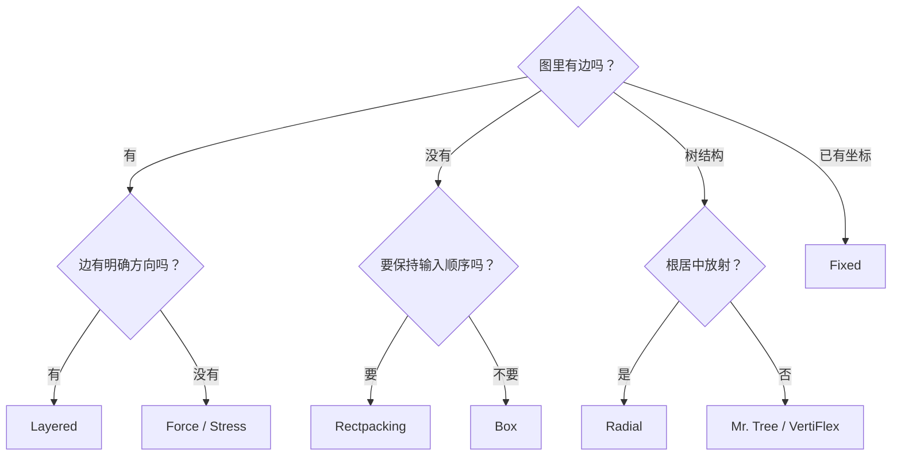

# 算法选型

完整入口 `ggn-layout` 注册 14 个 ELK 0.12.0 算法。Layered-only 入口只注册 `layered`。

## 先看图的形状

## 全部算法

| 算法 | ELK ID | 读边 | 典型用途 | 完整入口 | Layered-only |
| --- | --- | --- | --- | --- | --- |
| Layered | `org.eclipse.elk.layered` | 是 | 流程、依赖、状态、架构、compound graph | ✓ | ✓ |
| Box | `org.eclipse.elk.box` | 否 | 无边卡片、简单装箱 | ✓ | — |
| Fixed | `org.eclipse.elk.fixed` | 只保留输入 | 固定位置、手工布局回放 | ✓ | — |
| Random | `org.eclipse.elk.random` | 生成弯点 | 对照基线、演示 | ✓ | — |
| Force | `org.eclipse.elk.force` | 是 | 一般关系网络 | ✓ | — |
| Stress | `org.eclipse.elk.stress` | 是 | 均匀散布、距离保持 | ✓ | — |
| Rectpacking | `org.eclipse.elk.rectpacking` | 否 | 保持顺序的卡片墙、面板 | ✓ | — |
| Top-down Packing | `org.eclipse.elk.topdownpacking` | 否 | 自顶向下固定尺寸盒子 | ✓ | — |
| Mr. Tree | `org.eclipse.elk.mrtree` | 是 | 目录树、组织树 | ✓ | — |
| Radial | `org.eclipse.elk.radial` | 是 | 根居中的脑图 | ✓ | — |
| VertiFlex | `org.eclipse.elk.vertiflex` | 是 | 允许显式垂直约束的树 | ✓ | — |
| DisCo | `org.eclipse.elk.disco` | 组件边界 | 未连接分量打包 | ✓ | — |
| SPOrE Overlap | `org.eclipse.elk.sporeOverlap` | 否 | 重叠消除 | ✓ | — |
| SPOrE Compaction | `org.eclipse.elk.sporeCompaction` | 否 | 紧凑化已有布局 | ✓ | — |

## 最短选型规则

- **不确定就用 Layered**。它覆盖能力最多，也是 compound graph 的唯一白盒方案。
- **没有边**时不要用 Layered 强行排。Box / Rectpacking / Top-down Packing 更直接。
- **输入顺序重要**用 Rectpacking；**宽度近似重要**用 Box；**固定尺寸、可横向扩张**用 Top-down Packing。
- **树**优先 Mr. Tree；需要同心圆用 Radial；需要每层固定垂直位置用 VertiFlex。
- **已有坐标**用 Fixed；不要用 Layered 再排一次。
- **已经有重叠布局**用 SPOrE Overlap；需要保持拓扑继续压缩用 SPOrE Compaction。

## 算法与层级

非 Layered 子图通常是黑盒：子图先独立布局，然后作为固定尺寸节点参与父图。

- 黑盒内部边由子图算法处理；
- 从黑盒内部节点跨到外部的边通常不支持；
- 容器节点自身仍可参与父图边路由。

需要跨层级自由穿透时，使用 Layered + `INCLUDE_CHILDREN`。

## 官方参考

- [ELK Algorithms](https://eclipse.dev/elk/reference/algorithms.html)
- [ELK Layered](https://eclipse.dev/elk/reference/algorithms/org-eclipse-elk-layered.html)
- [ELK Box](https://eclipse.dev/elk/reference/algorithms/org-eclipse-elk-box.html)
- [ELK Rectangle Packing](https://eclipse.dev/elk/reference/algorithms/org-eclipse-elk-rectpacking.html)
