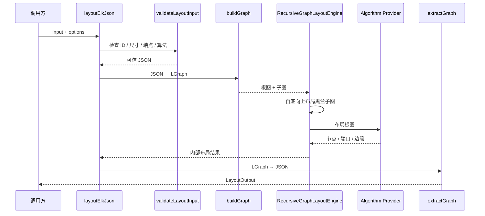

# 模块与调用链

## 一次调用实际发生什么



## 为什么先布局子图

父算法需要子图的最终宽高。否则父层只能根据初始尺寸摆放，子图变大后会穿出容器或压缩父层空间。

因此递归调度顺序不是“从根往下画”，而是：

```text
叶子子图布局 → 父容器尺寸确定 → 父图布局
```

## Layered 的两种层级路径

| 模式 | 行为 |
| --- | --- |
| `INCLUDE_CHILDREN` | 父子图共享同一套层级布局约束，跨组边可穿透 |
| `SEPARATE_CHILDREN` | 子图独立完成布局，父图把子容器当已知尺寸节点 |

`INCLUDE_CHILDREN` 的典型执行顺序：

1. 自底向上跑各子图的 pre-P3；
2. 只在根图跑 P3，交叉最小化能看到子图内容；
3. 自底向上跑 post-P3；
4. 最后合并 compound 边。

## 算法注册与 tree-shaking

完整入口：

```ts
import { layoutElkJson } from "ggn-layout";
```

会注册全部 provider。

只使用 Layered：

```ts
import { layoutElkJson } from "ggn-layout/layered";
```

不会把 Force、Radial、Mr. Tree、Rectpacking 等 provider 打进 bundle。传入未注册算法会明确报错，
不会静默退回 Layered。

## 坐标投影发生在最后

算法内部只处理一份几何。`shapeCoords` 和 `edgeCoords` 是输出投影选项，不参与布局决策。

这个边界保证：

- 同一算法结果可以投影成不同坐标形态；
- 相对坐标和根坐标不会产生两套布局；
- diff 可以在统一坐标模式下比较。

## 失败隔离

批量入口逐项捕获失败，不会让一项非法输入破坏整批结果。单项失败仍返回标准 `LayoutError` 信息。
