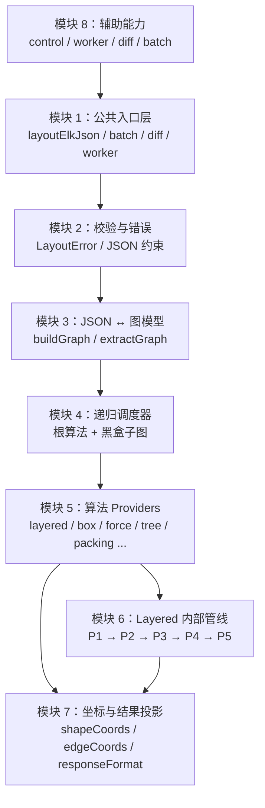
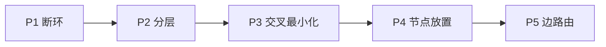

# 自顶向下看架构

`ggn-layout` 可以先只看成一条链：

```text
ELK JSON → 校验 → 内部图 → 递归算法调度 → 坐标投影 → 新 JSON
```

下面按依赖方向拆分模块。上层只需要知道下一层的公开契约，不反向依赖渲染。

## 整体架构



## 模块 1：公共入口层

入口负责稳定性，不负责算法细节。

```ts
layoutElkJson(input, options?)
layoutJsonBatch(inputs, options?)
diffLayout(before, after)
layoutJsonDiff(beforeInput, afterInput)
createLayoutWorker()
```

根入口 `ggn-layout` 注册全部算法。`ggn-layout/layered` 是只包含 Layered 的轻量入口，适合浏览器或
只需要层次布局的消费者。

## 模块 2：校验与错误

这一层先把输入变成可信数据：

- 节点、端口、边必须有唯一 ID；
- 尺寸不能为负，也不能是 `NaN` / `Infinity`；
- 每条边必须有且只有一个源、一个目标；
- 端点必须能解析到节点或端口；
- 根算法必须属于已移植集合。

失败统一抛 `LayoutError`，带 `code`、`path`、`retryable` 和可选 `phase`。

## 模块 3：JSON ↔ 图模型

`buildGraph` 把可序列化 JSON 转成内部 `LGraph`：

- 节点变成 `LNode`；
- 端口变成 `LPort`；
- 边变成 `LEdge`；
- `layoutOptions` 映射到内部属性；
- 嵌套 `children` 建立子图关系。

布局结束后，`extractGraph` 再把内部模型转回 JSON。内部类不属于公共契约。

## 模块 4：递归调度器

调度器对齐 ELK 的递归图布局模型：

1. 自底向上找出拥有独立算法的子图；
2. 先完成这些黑盒子图；
3. 把子图当作已知尺寸的节点交给父图；
4. 根算法完成父层布局；
5. 合并子图结果并投影坐标。

这解释了为什么同一个文档里可以出现“Layered 父层 + Box 子容器”或“Layered 父层 + Force 子图”。

## 模块 5：算法 Providers

每个算法通过注册表挂载：

```text
normalized algorithm id → provider(root)
```

已注册算法：

- `layered`
- `box` / `fixed` / `random`
- `force` / `stress`
- `rectpacking` / `topdownpacking`
- `mrtree` / `radial`
- `vertiflex` / `disco`
- `sporeoverlap` / `sporecompaction`

完整入口注册全部 provider；Layered-only 入口只注册 Layered。

## 模块 6：Layered 内部管线

Layered 自身再分五个阶段：



阶段之间允许插入 processor，例如断环后的边恢复、端口 dummy、长边拆分、标签占位和层级端口处理。
详细见 [Layered 五阶段](/architecture/layered-pipeline)。

## 模块 7：坐标与结果投影

内部算法通常在一个规范化方向坐标中计算，再由 GraphTransformer 转回请求方向。

输出阶段负责：

- 相对父节点或根坐标；
- 边段相对 LCA 或根坐标；
- 端口锚点与边端点对齐；
- `full` / `concise` / `summary` 裁剪。

## 模块 8：辅助能力

- `control`：阶段进度与合作式取消；
- `layout-worker`：Web Worker 外壳；
- `layoutJsonBatch`：批量、逐项失败隔离；
- `diffLayout`：节点和边的几何差异；
- `leafBaseline`：面向横向成分图的叶子底边对齐扩展。

## 不变量

整个实现围绕四条不变量：

1. 输入不被修改；
2. 同版本、同输入、同选项结果确定；
3. 内部模型不泄漏到结果；
4. 坐标投影不改变节点之间的几何关系，只改变参照系。
