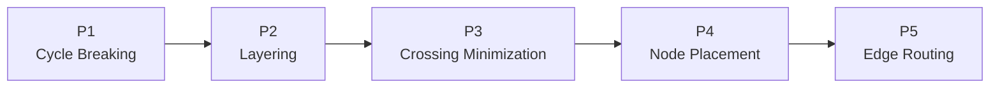

# Layered 五阶段

Layered 是 Sugiyama 类布局器：先决定边的方向，再把节点分层，层内减少交叉，最后给坐标并路由。

阶段之间不是空白。ELK 允许在每两个阶段前后插入 processor，处理长边 dummy、端口、标签、分区、
层级边恢复等跨阶段问题。

## P1：断环

有向图可能存在回边。P1 反转一部分边，形成 DAG；P5 后再恢复原方向。

常见策略：

| 策略 | 适合 |
| --- | --- |
| `GREEDY` | 默认，局部贪心减少回边 |
| `GREEDY_MODEL_ORDER` | 希望输入顺序约束断环 |
| `MODEL_ORDER` | 严格按模型顺序 |
| `DEPTH_FIRST` | DFS 回边语义 |
| `INTERACTIVE` | 增量布局，尽量保留旧方向 |

## P2：分层

P2 给每个节点分配 layer。层是阅读顺序的基础。

| 策略 | 特点 |
| --- | --- |
| `NETWORK_SIMPLEX` | 默认，最小化边长，质量与性能平衡 |
| `LONGEST_PATH_SOURCE` | 从源点向后推层 |
| `LONGEST_PATH_SINK` | 从汇点向前推层 |
| `COFFMAN_GRAHAM` | 可限制每层节点数 |
| `MIN_WIDTH` | 优先控制层宽 |
| `INTERACTIVE` | 根据已有坐标恢复层 |

约束：

- `layerConstraint: FIRST / LAST / FIRST_SEPARATE / LAST_SEPARATE`
- `layerChoiceConstraint` / `layerId`
- `partitioning.activate` + `partitioning.partition`

## P3：交叉最小化

P3 重排每层节点。默认 `LAYER_SWEEP`，用 barycenter / median 在相邻层之间迭代。

相关选项：

- `crossingMinimization.strategy`
- `greedySwitch.type`
- `greedySwitch.activationThreshold`
- `semiInteractive`
- `considerModelOrder.strategy`
- `forceNodeModelOrder`

如果业务顺序比交叉数更重要，应使用模型序或半交互，而不是不断调阈值。

## P4：节点放置

P4 把层内顺序变成坐标，同时尽量拉直长边。

| 策略 | 特点 |
| --- | --- |
| `BRANDES_KOEPF` | 默认，四向对齐后平衡，质量稳定 |
| `NETWORK_SIMPLEX` | 将间距和边长转成优化问题 |
| `LINEAR_SEGMENTS` | 按线性段移动节点 |
| `SIMPLE` | 简单堆放，适合调试 |
| `INTERACTIVE` | 尽量保持输入位置 |

相关选项：

- `nodePlacement.strategy`
- `favorStraightEdges`
- `nodePlacement.bk.fixedAlignment`
- `nodePlacement.bk.edgeStraightening`
- `nodePlacement.networkSimplex.nodeFlexibility`

## P5：边路由

P5 计算边弯点：

- `ORTHOGONAL`：水平/垂直折线，支持端口约束；
- `POLYLINE`：多段直线，适合一般关系图；
- `SPLINES`：平滑曲线，适合状态图或非工程图。

边路由还受这些参数影响：

- `spacing.edgeNode`
- `spacing.edgeEdge`
- `layered.spacing.edgeNodeBetweenLayers`
- `layered.spacing.edgeEdgeBetweenLayers`
- `mergeEdges`
- `unnecessaryBendpoints`

## Intermediate processors

常见跨阶段 processor：

| Processor | 作用 |
| --- | --- |
| `ReversedEdgeRestorer` | 恢复 P1 反转的边 |
| `LongEdgeSplitter` / `LongEdgeJoiner` | 长边拆 dummy、布局后合并 |
| `LabelDummyInserter` / `Remover` | 为中心边标签预留空间 |
| `CompoundGraphPreprocessor` / `Postprocessor` | 跨层级边和外部端口 |
| `PartitionPreprocessor` / `Postprocessor` | 强制分区顺序 |
| `NodePromotion` | 减少长边 dummy，压缩图 |
| `HierarchicalPortPositionProcessor` | 计算容器端口 |

## 为什么“调一个参数”经常没有效果

参数属于某一段决策：

- 改 `spacing.nodeNode` 不会改变谁和谁同层；
- 改 `nodePlacement` 不会改变层的先后；
- 改 `edgeRouting` 不会改变节点的层级与顺序；
- 改 `portConstraints` 会同时限制 P3、P4 和 P5。

先判断问题发生在“层、顺序、坐标、路由”哪一段，再选参数。
