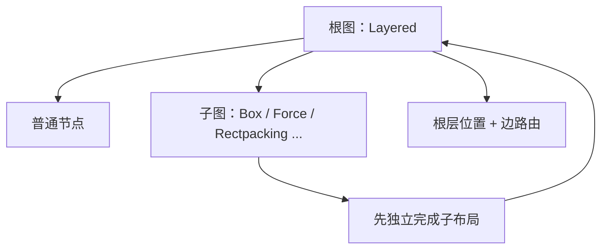

# 图模型与坐标

## 一张图只有五类元素

| 元素 | 作用 |
| --- | --- |
| 图 / 节点 | 承载子节点、端口、标签和边；根图也是一个节点 |
| 端口 | 边的具名连接点，可以约束在某一侧或某一位置 |
| 标签 | 节点、端口或边上的矩形文本区域 |
| 边 | 单源、单目标连接；当前入口拒绝超边 |
| 边段 | 算法输出的 `startPoint`、`bendPoints`、`endPoint` |

节点尺寸由调用方提供。布局器不会测量文字，也不会读取字体。标签必须带 `width` 和 `height`。

## 父子关系决定局部坐标系

`children` 是包含关系的唯一真源。边的坐标相对于它声明所在的图中，输出还会给出 `container` 表示
实际的最低公共祖先（LCA）。

默认输出：

- 子节点 `x/y` 相对父节点；
- 边段相对边的 LCA 容器。

使用 `shapeCoords: ROOT` 和 `edgeCoords: ROOT` 可把两者投影到根坐标。投影只改变坐标值，不改变布局结果。

## 算法作用于根图，黑盒子图先独立布局

根节点的 `org.eclipse.elk.algorithm` 决定根层算法。非 Layered 子图会先由自己的算法完成布局，再作为
固定尺寸的“黑盒”参与父图布局。



跨出黑盒内部节点的边通常不被支持。让顶层算法路由“容器节点本身”与其它节点的边，是更稳定的拆法。

## 端口约束决定边的锚点自由度

| 值 | 含义 |
| --- | --- |
| `FREE` | 侧边和位置都由算法决定 |
| `FIXED_SIDE` | 侧边固定，槽位可移动 |
| `FIXED_ORDER` | 同侧顺序固定 |
| `FIXED_RATIO` | 沿边比例固定，允许尺寸变化时缩放 |
| `FIXED_POS` | 绝对位置固定 |

约束越强，算法可优化空间越小，但语义越稳定。

## JSON 键有长名和短名

规范键：

```text
org.eclipse.elk.layered.layering.strategy
```

兼容短键：

```text
elk.layered.layering.strategy
```

入口会统一解析。文档优先写规范键，避免把短键当成唯一接口。

## 布局结果是“几何”，不是“渲染指令”

结果只告诉你节点和边在哪里。如何画线、箭头、底色、圆角和文字，属于上层图形库。
